# Multithreaded Programming with Pthreads and OpenMP

---


## Executive Summary

This repository documents the implementation and performance evaluation of **multithreaded programming with POSIX Threads (Pthreads) and OpenMP**. It examines thread creation, workload distribution, concurrency hazards, synchronization mechanisms, and scalability using a numerical workload of **$1,000,000,000$ iterations ($10^9$)**.

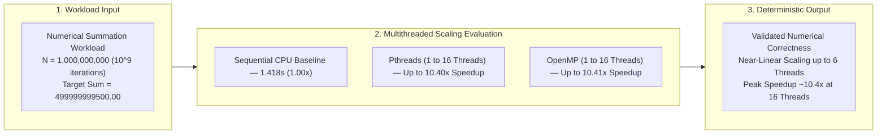

### Key Findings

> **Both Pthreads and OpenMP achieved near-linear speedup up to 6 threads (approximately 5.90× speedup and 98.4% parallel efficiency). At 16 threads, the measured speedup reached approximately 10.4×, reducing execution time from 1.418 s to 0.136 s. OpenMP delivered performance comparable to manually managed Pthreads while substantially reducing thread-management code.**

---

## Table of Contents

1. [Repository Structure](#repository-structure)
2. [Experiment Objectives](#1-experiment-objectives)
3. [Theoretical and Architectural Comparison](#2-theoretical--architectural-comparison)
4. [Workload Specification](#3-workload-specification)
5. [Source Code References](#4-source-code-references)
6. [Empirical Results & Screenshots](#5-empirical-results--screenshots)
7. [Performance Comparison & Visualizations](#6-performance-comparison--visualizations)
8. [Technical Analysis & Discussion](#7-technical-analysis--discussion)
9. [Conclusion and Engineering Takeaways](#8-conclusion--engineering-takeaways)

---


## 1. Experiment Objectives

1. **Thread lifecycle management:** Examine explicit thread creation, parameter passing, and synchronization with `pthread_create()` and `pthread_join()`, and compare this approach with OpenMP’s runtime-managed threads.
2. **Work partitioning:** Divide data structures into non-overlapping index ranges and assign them to concurrent worker threads.
3. **Concurrency hazards:** Demonstrate race conditions that can occur when multiple threads perform unsynchronized read-modify-write operations on shared variables.
4. **Synchronization mechanisms:** Use mutex locks (`pthread_mutex_t`) and OpenMP critical sections (`#pragma omp critical`) to protect shared data.
5. **Thread coordination:** Synchronize execution phases across a team of threads using barriers (`#pragma omp barrier`).
6. **Scalability benchmarking:** Measure execution time, speedup, and parallel efficiency at $1, 2, 4, 6,$ and $16$ threads for a numerical workload of $10^9$ iterations.

---

## 2. Theoretical and Architectural Comparison

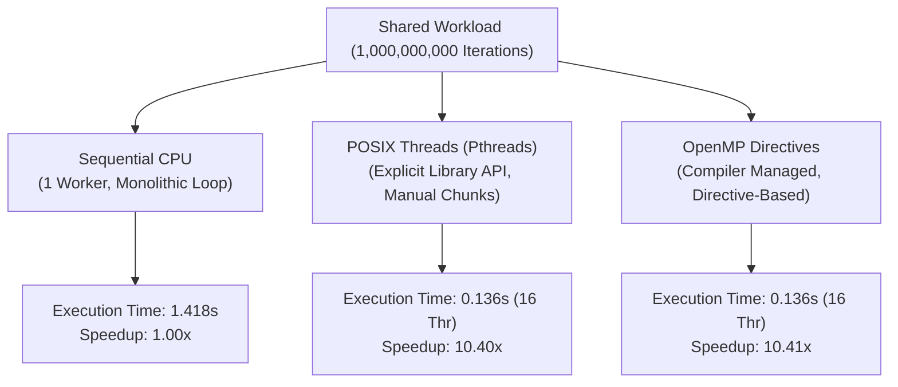

### Architectural Overview

#### 1. Sequential Execution (Single Worker)
In sequential execution, one CPU thread processes the loop iterations in order, from beginning to end, without parallel execution.

```
Sequential Execution (1 Core):
Main Thread ─── Chunk 1 ─── Chunk 2 ─── Chunk 3 ─── Chunk 4 ─── Finish
```

#### 2. POSIX Threads (Pthreads)
Pthreads provides a low-level C programming interface through `<pthread.h>`. The programmer defines worker functions, manages thread handles (`pthread_t`), calculates workload boundaries, and explicitly synchronizes shared-memory access using mutexes (`pthread_mutex_t`).

```
Pthreads Explicit Architecture:
                ┌─── Worker Thread 1 ─── Chunk 1 ───┐
                ├─── Worker Thread 2 ─── Chunk 2 ───┤
Master Spawn ───┼─── Worker Thread 3 ─── Chunk 3 ───┼─── pthread_join() ─── Aggregated Result
                └─── Worker Thread 4 ─── Chunk 4 ───┘
```

#### 3. OpenMP (Compiler Directives)
OpenMP provides high-level compiler directives such as `#pragma omp`. Its compiler and runtime support thread-team management, work distribution through scheduling clauses, reductions such as `reduction(+:sum)`, and implicit synchronization at the end of parallel regions.

```
+-----------------------------------------------------------------------------+
|                           PTHREADS VS. OPENMP COMPARISON                    |
+--------------------------+----------------------------+---------------------+
| Feature                  | POSIX Threads (Pthreads)   | OpenMP              |
+--------------------------+----------------------------+---------------------+
| Paradigm                 | Explicit low-level C API   | Declarative pragmas |
| Thread Spawning          | Manual `pthread_create()`  | `#pragma omp parallel` |
| Thread Joining           | Manual `pthread_join()`    | Automatic barrier   |
| Work Distribution        | Manual index arithmetic    | Automatic loop work-sharing |
| Synchronization          | `pthread_mutex_lock/unlock`| `#pragma omp critical` |
| Reduction                | Manual per-thread arrays   | `reduction(+:var)`  |
| Boilerplate Overhead     | High (~60-90 lines)        | Minimal (~5-10 lines) |
+--------------------------+----------------------------+---------------------+
```

---

## 3. Workload Specification

- **Problem Size ($N$)**: $1,000,000,000$ iterations ($10^9$)
- **Per-Iteration Computation**: $i \times 10^{-6}$
- **Mathematical Invariant & Target Result**:
  $$\text{Target Sum} = \sum_{i=0}^{10^9 - 1} (i \times 10^{-6}) = \mathbf{499999999500.00}$$
- **Hardware platform:** A multicore processor with 32 logical threads, running Ubuntu through WSL2.

---

## 4. Source Code References

All source-code implementations are located in the [`src/`](src/) directory:

| Section | Paradigm / Concept | Source File Link | Key API / Pragma Highlights |
| :--- | :--- | :--- | :--- |
| **Pthreads** | Single Thread Creation | [`src/pthreads/thread1.c`](src/pthreads/thread1.c) | `pthread_create()`, `pthread_join()` |
| **Pthreads** | Multiple Thread Spawning | [`src/pthreads/thread2.c`](src/pthreads/thread2.c) | Thread ID parameter passing via structs |
| **Pthreads** | Work Distribution & Chunking | [`src/pthreads/thread_sum.c`](src/pthreads/thread_sum.c) | Range chunking & per-thread partial sums |
| **Pthreads** | Race Condition Demonstration | [`src/pthreads/race.c`](src/pthreads/race.c) | Unsynchronized concurrent counter access |
| **Pthreads** | Mutex Mutual Exclusion | [`src/pthreads/mutex.c`](src/pthreads/mutex.c) | `pthread_mutex_lock()`, `pthread_mutex_unlock()` |
| **Pthreads** | Scalability Performance Test | [`src/pthreads/pthread_perf.c`](src/pthreads/pthread_perf.c) | Numerical summation across 1, 2, 4, 6, 16 threads |
| **OpenMP** | Parallel Region & Thread IDs | [`src/openmp/omp1.c`](src/openmp/omp1.c) | `#pragma omp parallel`, `omp_get_thread_num()` |
| **OpenMP** | Work Sharing & Reduction | [`src/openmp/omp_sum.c`](src/openmp/omp_sum.c) | `#pragma omp parallel for reduction(+:sum)` |
| **OpenMP** | Race Condition Hazard | [`src/openmp/omp_race.c`](src/openmp/omp_race.c) | Unprotected shared variable accumulation |
| **OpenMP** | Critical Section Lock | [`src/openmp/omp_critical.c`](src/openmp/omp_critical.c) | `#pragma omp critical` synchronization |
| **OpenMP** | Phased Barrier Coordination | [`src/openmp/omp_barrier.c`](src/openmp/omp_barrier.c) | `#pragma omp barrier` synchronization point |
| **OpenMP** | Scalability Performance Test | [`src/openmp/omp_perf.c`](src/openmp/omp_perf.c) | Numerical summation across 1, 2, 4, 6, 16 threads |
| **Baseline** | Single-Threaded Sequential | [`src/sequential/sequential.c`](src/sequential/sequential.c) | Unthreaded baseline reference implementation |

---

## 5. Experimental Results and Screenshots

### 5.1 Environment Setup and Verification
The following screenshot verifies the GCC 15.2.0 toolchain and the active WSL2 Linux environment.


---

### 5.2 Part A — POSIX Threads (Pthreads)

#### Single Thread & Multi-Thread Execution
These examples demonstrate how to create and join one or more worker threads while tracking their thread IDs.

| Single Thread Creation (`thread1.c`) | Multiple Thread Spawning (`thread2.c`) |
| :---: | :---: |
|  |  |

#### Work Distribution & Array Chunking (`thread_sum.c`)
Array indices are divided into uniform chunks, and each worker accumulates a partial sum for its assigned range.


#### Concurrency Hazards & Mutex Fix
These examples contrast incorrect results caused by a race condition with correct, synchronized execution using `pthread_mutex_t`.

| Race Condition Hazard (`race.c`) | Mutex Synchronization Fix (`mutex.c`) |
| :---: | :---: |
|  |  |

---

### 5.3 Part B — OpenMP Directives

#### Parallel Region & Thread Teams (`omp1.c`)
This example demonstrates the OpenMP fork-join model, in which a team of threads executes a parallel region and synchronizes at its end.

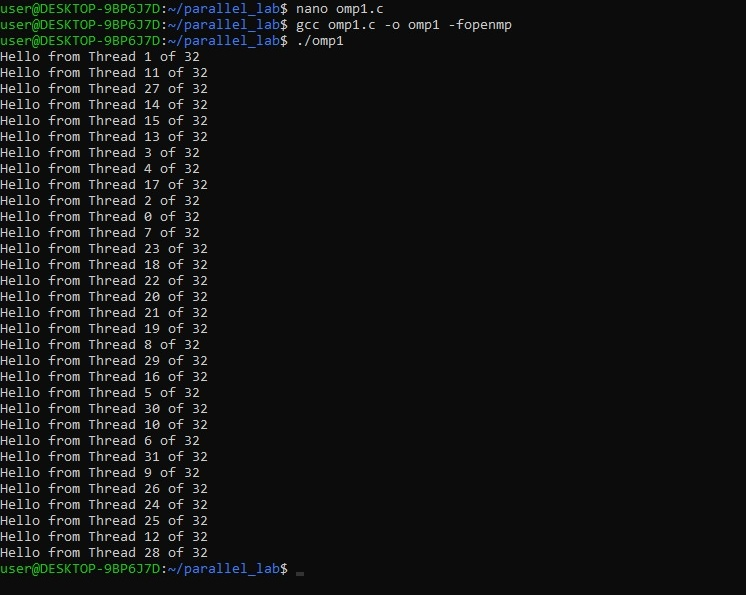

#### Work-Sharing Loops & Reduction (`omp_sum.c`)
This example demonstrates loop work-sharing and the use of a reduction clause to combine partial numerical results.

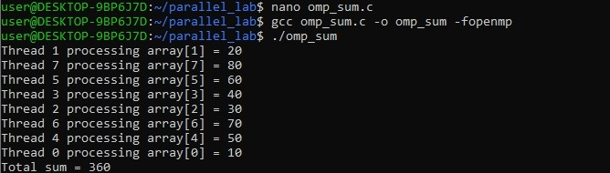

#### Data Hazards & Critical Section Synchronization
These examples compare race-condition behaviour with synchronized execution using `#pragma omp critical`.

| OpenMP Race Condition (`omp_race.c`) | OpenMP Critical Section (`omp_critical.c`) |
| :---: | :---: |
|  | 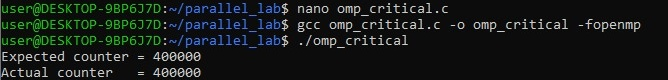 |

#### Phased Barrier Coordination (`omp_barrier.c`)
A barrier provides a synchronization point: each participating thread waits until all threads in the team have reached it.

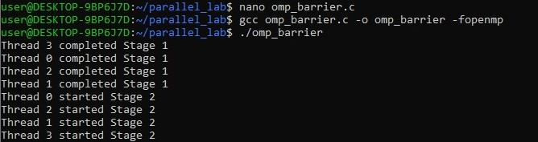

---

### 5.4 Part C — Scalability Benchmarks

#### Sequential Baseline Runtime
The sequential implementation provides the baseline runtime: **`1.418018 seconds`**.


#### Pthreads Scalability Benchmarks (`pthread_perf.c`)
The benchmark evaluates 1, 2, 4, 6, and 16 threads. The lowest reported runtime is **`0.136414 seconds`**.

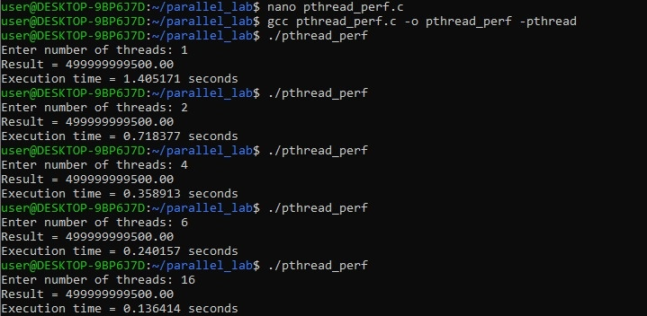

#### OpenMP Scalability Benchmarks (`omp_perf.c`)
The benchmark evaluates 1, 2, 4, 6, and 16 threads. The lowest reported runtime is **`0.136195 seconds`**.

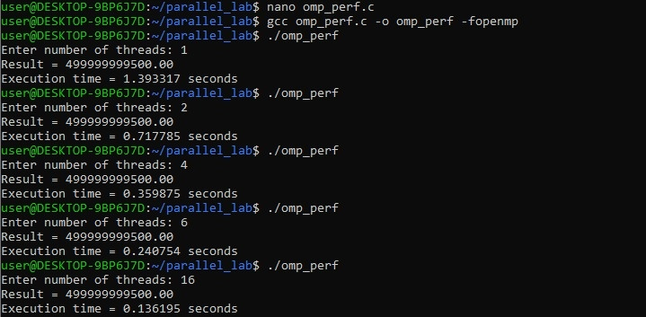

---

## 6. Performance Comparison and Visualizations

### 6.1 Execution Time and Scalability Results

| Thread Count ($P$) | Sequential Baseline | Pthreads Time | OpenMP Time | Pthreads Speedup | OpenMP Speedup | Pthreads Efficiency | OpenMP Efficiency |
| :---: | :---: | :---: | :---: | :---: | :---: | :---: | :---: |
| **1 Thread** | 1.418018 s | **1.405171 s** | **1.393317 s** | **1.009×** | **1.018×** | **100.91%** | **101.77%** |
| **2 Threads** | — | **0.718377 s** | **0.717785 s** | **1.974×** | **1.976×** | **98.70%** | **98.78%** |
| **4 Threads** | — | **0.358913 s** | **0.359875 s** | **3.951×** | **3.940×** | **98.77%** | **98.51%** |
| **6 Threads** | — | **0.240157 s** | **0.240754 s** | **5.905×** | **5.890×** | **98.41%** | **98.16%** |
| **16 Threads** | — | **0.136414 s** | **0.136195 s** | **10.395×** | **10.412×** | **64.97%** | **65.07%** |

$$\text{Speedup } (S) = \frac{T_{\text{sequential}}}{T_{\text{parallel}}}, \quad \text{Efficiency } (E) = \frac{S}{P} \times 100\%$$

---

### 6.2 Performance Charts

#### Three-Panel Benchmark Overview
The charts compare execution time, speedup, and parallel efficiency for Pthreads, OpenMP, and the sequential baseline.

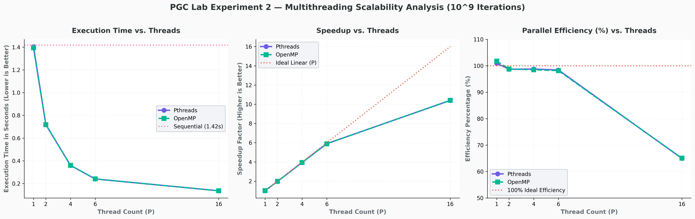

#### Individual Scaling Curves
| Execution Time Scaling | Speedup vs. Ideal Scaling | Parallel Efficiency (%) |
| :---: | :---: | :---: |
| 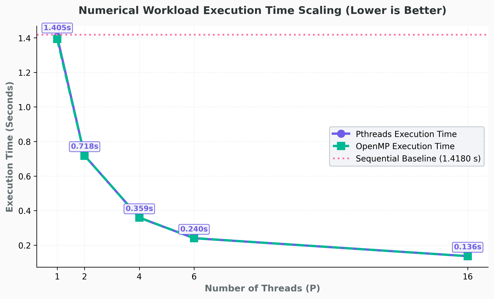 | 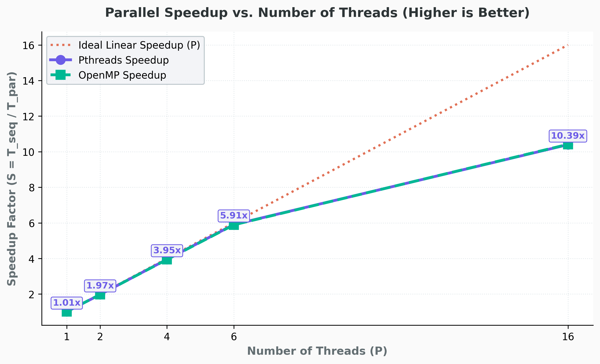 | 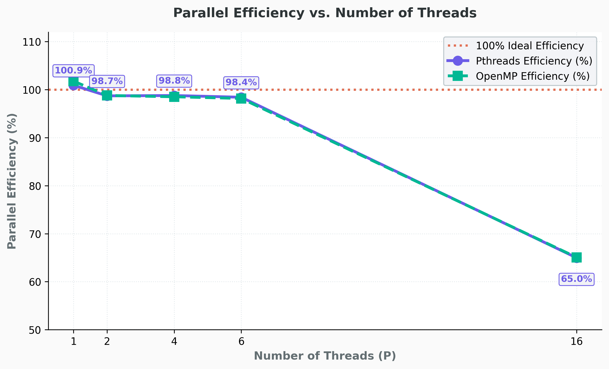 |

---

## 7. Technical Analysis and Discussion

1. **Near-linear scaling from 1 to 6 threads:** Both Pthreads and OpenMP achieve near-linear speedup between 1 and 6 threads: approximately $1.97\times$ with 2 threads, $3.95\times$ with 4 threads, and $5.90\times$ with 6 threads. Parallel efficiency remains above **$98.4\%**. Contiguous work partitioning can also support locality by allowing threads to process sequential memory ranges.
2. **Comparable Pthreads and OpenMP performance:** The measured runtimes are very similar across the tested thread counts. At 16 threads, Pthreads records $0.136414\text{s}$ and OpenMP records $0.136195\text{s}$. These measurements indicate comparable performance for this workload; they do not, by themselves, establish that scheduling is optimal or that runtime abstraction never introduces overhead.
3. **Scaling limitations at 16 threads:** At 16 threads, the reported OpenMP speedup is **$10.41\times$**, below the ideal $16\times$, and parallel efficiency falls to **$65.07\%**. Possible contributing factors include:
   - **Simultaneous multithreading (SMT):** Logical processors share resources within a physical core and therefore do not necessarily provide the throughput of additional physical cores.
   - **Memory bandwidth and cache effects:** Increased concurrent access can place additional pressure on shared caches and memory bandwidth.
   - **Serial and coordination overhead:** Thread management, synchronization, and reduction work limit the achievable speedup, as described by Amdahl's law.

---

## 8. Conclusion and Engineering Takeaways

1. **Scalability:** Multithreading can substantially reduce execution time, but scaling is limited by hardware resources, memory behaviour, and parallel overhead as thread counts increase.
2. **Synchronization and correctness:** Shared-memory programs must protect conflicting accesses to shared data. Mutexes and critical sections are synchronization mechanisms that can prevent race conditions when used correctly.
3. **Productivity and control:** OpenMP offers a concise, directive-based approach to loop-level parallelism, while Pthreads provides more explicit control over thread creation and coordination. In these measurements, both approaches deliver comparable performance, so OpenMP can be a practical choice when simplicity and maintainability are priorities.


## Student Details

- **Name:** Hrishikesh Patil
- **Roll No.:** 109
- **USN:** 01FE24BCI043

---
